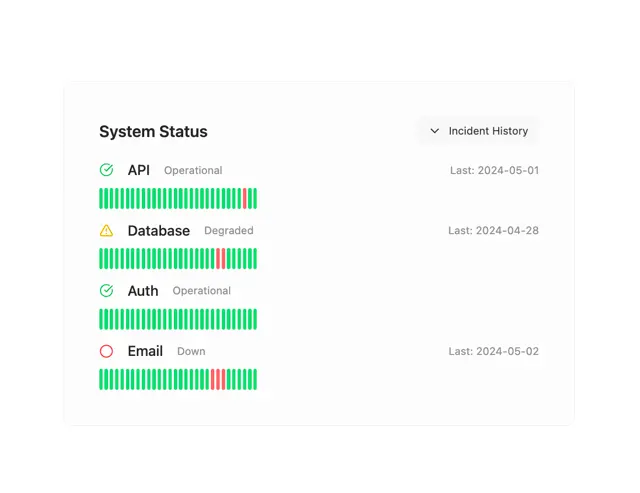

# System Status card: API, Database, Auth and Email rows with status icons and long strips of green and red uptime bars

**Discipline:** web · **Design type:** Data visualization
**Tags:** component, status, uptime, green, red, bars, white, monitoring

## What it is
A white rounded card with a bold title and an Incident History dropdown, and four service rows each with a status icon (green check, yellow warning, green check, red circle), a name, a grey status word (Operational, Degraded, Down), a last-incident date and a strip of thin vertical bars in green with a few red ones.

## What it means
Clear and reassuring; strips of bars show history at a glance and red marks show incidents.

## Techniques
- Show uptime as a strip of thin bars.
- Use a status icon and word per service.
- Mark incidents with red bars.
- Add an incident history control.

## Best for
- Status pages
- Monitoring dashboards
- Uptime components

## Vocabulary
- **Uptime bar** — A strip of small bars, one per time slot.
- **Status icon** — An icon showing operational, degraded or down.
- **Incident marker** — A red bar marking a failure.
- **Last incident date** — A grey date of the most recent issue.
