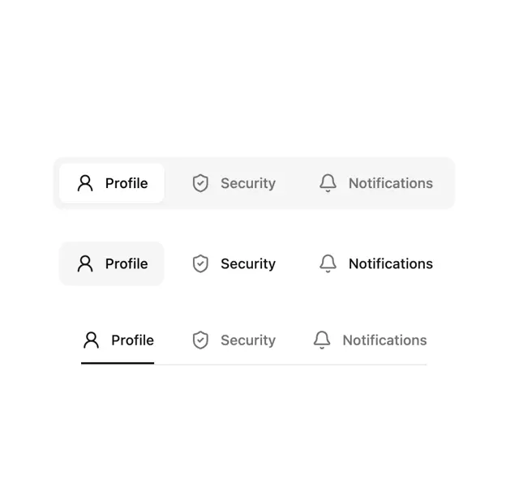

# Three tab bar styles for Profile, Security and Notifications: raised white pill in a grey track, soft-filled pill and underline

**Discipline:** web ·  · **Design style:** Minimalist
**Tags:** component, tabs, navigation, icons, white, grey, black, variants

## What it is
A white board with three rows of the same three tabs with line icons: a grey rounded track with the active Profile in a white raised pill, a version where the active tab has a soft grey fill, and a version with a black underline under the active tab on a hairline.

## What it means
Systematic and calm; showing three active-state treatments side by side helps choose one.

## Techniques
- Show the same tabs in multiple styles.
- Use thin icons before labels.
- Mark active with a raised pill, tint or underline.
- Keep everything neutral.

## Best for
- Tab component documentation
- Settings navigation
- Neutral UI kits

## Vocabulary
- **Segmented tabs** — Tabs inside a shared rounded track.
- **Underline tabs** — Tabs marked by a line beneath the active one.
- **Raised pill** — An active tab shown as a white capsule with a shadow.
- **Icon tab** — A tab combining an icon and a label.
