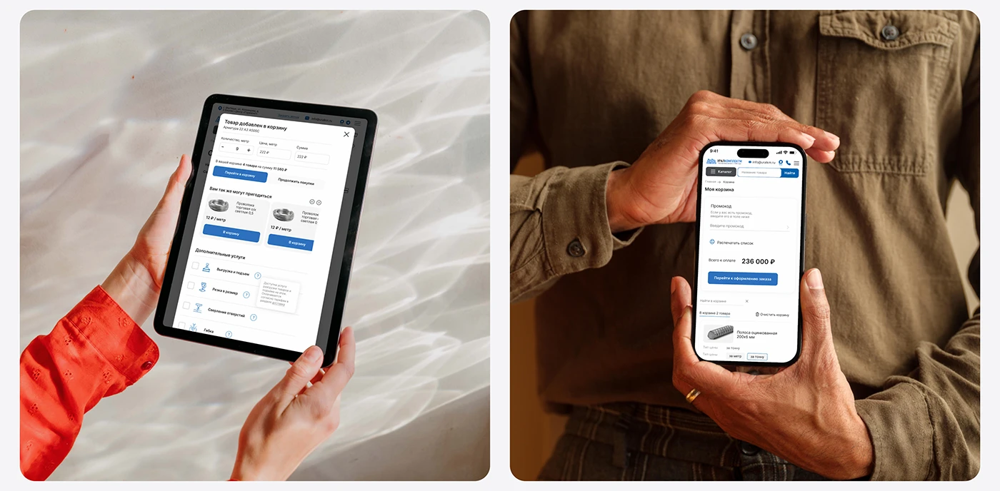

# Two rounded photos: hands holding a tablet with an add-to-cart modal against rippled light, and hands holding a phone cart against an olive shirt

**Discipline:** web ·  · **Design style:** Corporate & Clean-Tech
**Tags:** mockup, hands, tablet, phone, cart, blue, water-light, olive

## What it is
A pale board with two rounded photographs: a woman's hands in a red shirt hold a tablet showing an added-to-cart modal with recommendations and service checkboxes over glittering white water reflections, and a man's hands in an olive shirt hold a phone with a cart, promo field, total and a blue checkout button.

## What it means
Human and reassuring; hands make each state feel usable.

## Techniques
- Show hands on the device in two different settings.
- Use colourful clothing as a backdrop.
- Keep the UI white with blue actions.
- Frame each photo as a rounded card.

## Best for
- Cart and modal state showcases
- Hands-and-device photography
- B2B commerce case studies

## Vocabulary
- **Hands-on mockup** — A device held by hands in a real scene.
- **Water light** — Rippled light reflections as a backdrop.
- **Add-to-cart modal** — A dialog after adding an item.
- **Clothing backdrop** — A garment used as a background.
