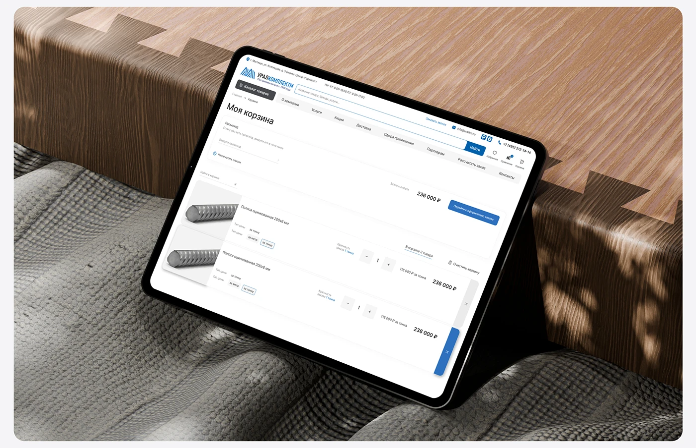

# Industrial cart page on a tablet between notched timber and grey knitted fabric

**Discipline:** web ·  · **Design style:** Warm & Organic
**Tags:** tablet, mockup, cart, wood, knit, texture, white-ui, blue, cyrillic

## What it is
An angled tablet with a white cart page showing two steel bar products, quantity steppers, totals and a blue checkout button, resting against a dovetailed wooden block and a grey woven textile in dappled light.

## What it means
Tactile and calm; natural textures make a utilitarian page feel considered.

## Techniques
- Set a functional UI in a scene of natural materials.
- Use dappled shadows for atmosphere.
- Keep the screen white with a single blue action.
- Frame in a rounded card.

## Best for
- E-commerce and cart flow presentations
- B2B web case studies
- Texture-rich mockups

## Vocabulary
- **Material contrast** — A digital screen against organic textures.
- **Dappled light** — Shadow patterns from leaves.
- **Cart table** — A list of items with quantities and prices.
- **Tablet mockup** — A tablet displaying a UI.
