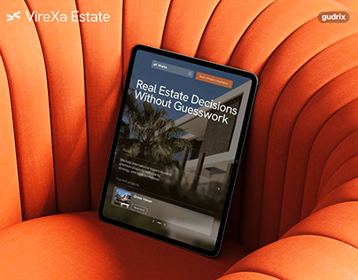

# Real-estate site on a tablet resting in an orange ribbed armchair

**Discipline:** web · **Design type:** Device mockup scene
**Tags:** mockup, tablet, real-estate, orange, fluted-upholstery, dark-ui, project-cover

## What it is
A tablet leaning in a deeply ribbed orange armchair. The screen shows a dark hero with a palm and modernist building photo, a headline 'Real Estate Decisions Without Guesswork' and small property cards. A logo and studio tag sit in corners.

## What it means
Warm and confident; a saturated orange fabric gives a serious dark UI a tactile, luxurious frame.

## Techniques
- Pick a textured, saturated furniture piece as the stage for a dark UI.
- Use ribbed lines of the upholstery as a pattern that leads to the screen.
- Keep corner labels small so the scene leads.
- Photograph at an angle in soft light.

## Best for
- Real-estate and lifestyle site showcases
- Case-study covers
- Dark UI presentations wanting warmth

## Vocabulary
- **Fluted upholstery** — Fabric or leather with vertical ridges.
- **Colour-contrast stage** — A scene whose colour contrasts strongly with the UI.
- **Tablet mockup** — A tablet displaying an interface in a scene.
- **Corner tag** — Small brand labels in frame corners.
