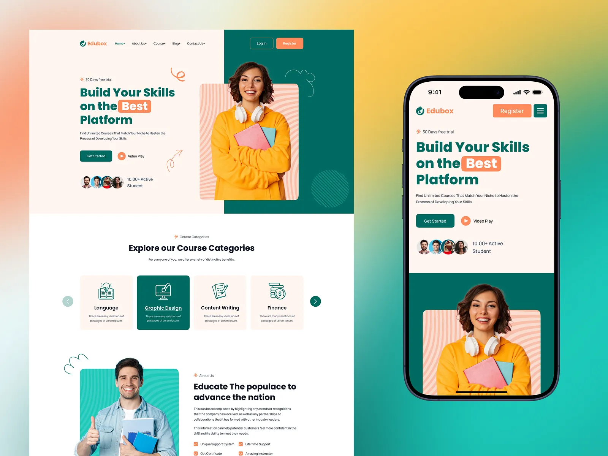

# Edubox landing page in deep teal, peach and orange with a hero portrait, category cards and a matching mobile screen on a teal gradient

**Discipline:** web · **Design type:** Landing page
**Tags:** education, teal, peach, orange, hero-portrait, category-cards, mobile, gradient-backdrop

## What it is
A gradient backdrop (coral, yellow, teal) with a desktop page in peach and deep teal: a headline 'Build Your Skills on the Best Platform' with 'Best' in an orange pill, Get Started and Video Play buttons, student avatars, a portrait of a woman in a yellow hoodie on a striped peach card over teal, a row of category cards (Language, Graphic Design highlighted in teal, Content Writing, Finance) and an About block; beside it a phone with the same hero.

## What it means
Energetic and reassuring; teal and orange make education feel fresh.

## Techniques
- Highlight one word in an orange pill.
- Place the hero portrait on a striped card.
- Highlight the selected category in teal.
- Repeat the hero on mobile.

## Best for
- Education and online course sites
- Teal-orange palettes
- Hero portrait layouts

## Vocabulary
- **Word pill** — A headline word set inside a coloured pill.
- **Striped portrait card** — A photo on a card with a wavy line pattern.
- **Category card** — A card with an icon and a subject.
- **Avatar row** — A row of small student portraits.
