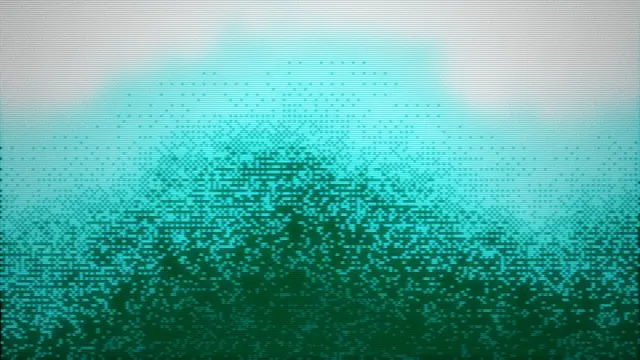

# Teal dithered pixel gradient rising from deep green to white with scanlines

**Discipline:** web ·  · **Design style:** Retro & Pixel
**Tags:** pattern, dither, teal, pixel, scanlines, gradient, retro, background

## What it is
A wide image where a mountain-like mass of teal and dark green pixel dither rises against a white-to-cyan sky, with faint horizontal scanlines.

## What it means
Retro-digital and cool; dither turns a gradient into a texture.

## Techniques
- Build a gradient from dithered pixels.
- Add scanlines.
- Keep to teal, green and white.
- Use as a hero or cover backdrop.

## Best for
- Backgrounds for tech covers
- Retro CRT aesthetics
- Texture assets

## Vocabulary
- **Dither** — A pattern of dots that simulates a gradient.
- **Scanlines** — Thin horizontal lines like a CRT.
- **Pixel mountain** — A shape formed by pixel noise.
- **Retro digital** — A look from early computing.
