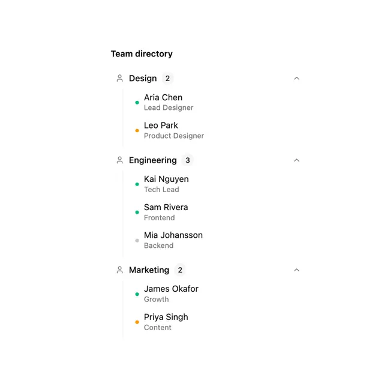

# 'Team directory' with collapsible Design, Engineering and Marketing groups, counts, a vertical guide line and green, amber and grey status dots

**Discipline:** web ·  · **Design style:** Minimalist
**Tags:** component, directory, collapsible, status-dots, white, green, amber, list

## What it is
A white column with a bold title and three groups, each with a person icon, a bold department name, a small grey count pill and an up chevron, followed by an indented list on a thin vertical line of names with roles and small green, amber or grey dots.

## What it means
Clear and calm; nesting and dots show structure and presence together.

## Techniques
- Group people under collapsible headings.
- Show counts in pills.
- Indent lists on a thin guide line.
- Use dots for availability.

## Best for
- Team directories
- Grouped list components
- Presence indicators

## Vocabulary
- **Collapsible group** — A heading that expands to show its items.
- **Count pill** — A small capsule with a number.
- **Guide line** — A thin vertical line marking indentation.
- **Status dot** — A small dot showing availability.
