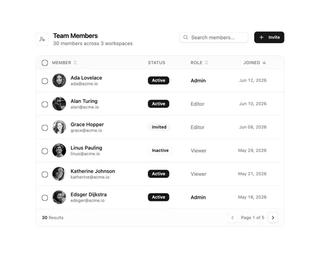

# 'Team Members' table with search, black Invite button, sortable columns, avatar rows with black Active badges and a paged footer

**Discipline:** web ·  · **Design style:** Corporate & Clean-Tech
**Tags:** component, table, members, black, white, badges, checkboxes, pagination

## What it is
A white bordered card with an icon tile and 'Team Members / 30 members across 3 workspaces', a Search members field and a black Invite button, a header row with a select-all circle and sortable Member, Status, Role and Joined columns, six rows with a checkbox, round avatar, name and email, a black Active or pale Invited or Inactive badge, a role in black or grey and a date, and a footer '30 Results' with 'Page 1 of 5' arrows.

## What it means
Efficient and neutral; black badges for active and pale ones for others create hierarchy without colour.

## Techniques
- Use black for active status and pale for inactive.
- Add sort arrows on headers.
- Put avatar, name and email in one cell.
- Finish with results count and pager.

## Best for
- Admin and team management tables
- Monochrome data tables
- User directories

## Vocabulary
- **Sortable header** — A column title with a sort arrow.
- **Status badge** — A capsule showing state such as Active.
- **Bulk select circle** — A control that selects all rows.
- **Table footer** — A row with count and pagination.
