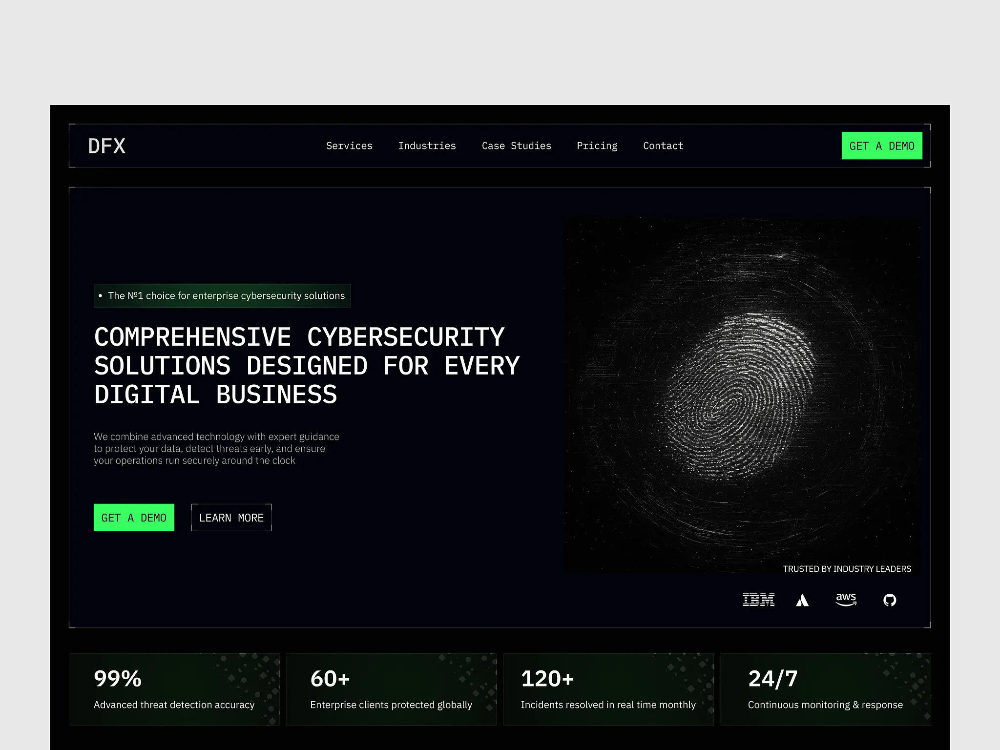

# Black monospace cybersecurity hero with corner brackets, green CTA, glitchy fingerprint image and stat tiles

**Discipline:** web ·  · **Design style:** Neo-Brutalist
**Tags:** cybersecurity, monospace, black, neon-green, corner-brackets, fingerprint, stat-tiles, logos

## What it is
A black page in a grey frame with bracketed nav, monospace uppercase headline 'COMPREHENSIVE CYBERSECURITY SOLUTIONS DESIGNED FOR EVERY DIGITAL BUSINESS', a green tag, green and outlined buttons, a scanned white fingerprint image, partner logos and four dark green stat tiles (99%, 60+, 120+, 24/7).

## What it means
Technical and secure; monospace and neon green feel like a terminal.

## Techniques
- Use monospace headlines and corner brackets.
- Render the hero as a noisy fingerprint scan.
- Use one neon green for actions.
- End with a row of stat tiles.

## Best for
- Cybersecurity and infrastructure sites
- Terminal-style dark UIs
- Green-on-black brands

## Vocabulary
- **Corner brackets** — Small L marks framing sections.
- **Monospace headline** — A headline in fixed-width type.
- **Scan image** — A noisy image resembling a scan.
- **Stat tile** — A dark tile with one big figure.
