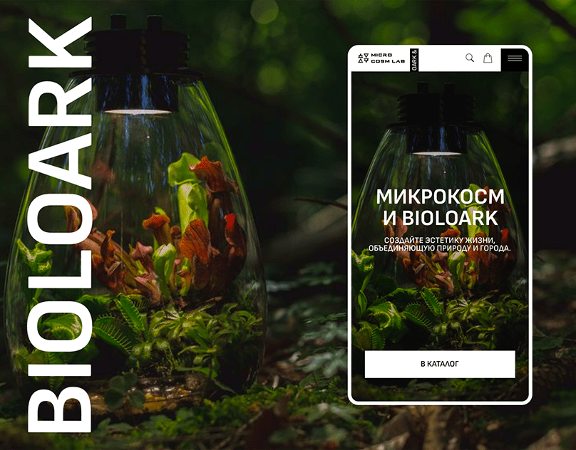

# Glass terrarium photo with giant vertical white BIOLOARK and a mobile hero with a black CTA

**Discipline:** web ·  · **Design style:** Glassmorphism
**Tags:** nature, terrarium, dark-green, vertical-title, mobile-hero, photography, product, cyrillic

## What it is
A dark forest-green photo of a glass teardrop terrarium with carnivorous plants and a lamp cap, a huge rotated white 'BIOLOARK' along the left edge and a white-bordered phone showing the same photo with a small logo, a centred headline and a wide black 'В КАТАЛОГ' button.

## What it means
Immersive and quiet; a giant rotated word and the plant image feel like a nature documentary.

## Techniques
- Rotate a giant white word up the edge.
- Use a moody macro nature photo.
- Show a phone with the same photo.
- Add a wide black CTA at the bottom.

## Best for
- Nature and plant product sites
- Photo-led mobile heroes
- Vertical title layouts

## Vocabulary
- **Vertical giant title** — A huge word rotated 90 degrees.
- **Macro nature photo** — A close image of plants.
- **Photo continuity** — The same image used on poster and screen.
- **Wide CTA bar** — A full-width button.
