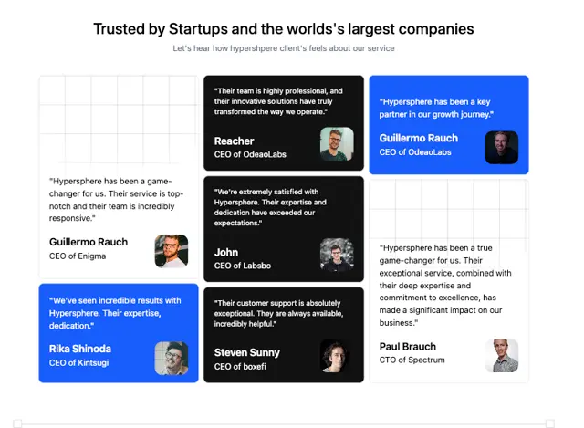

# 'Trusted by Startups' testimonial mosaic in black, royal blue and white cards with square-cropped avatars and CEO titles

**Discipline:** web ·  · **Design style:** Geometric & Bauhaus
**Tags:** testimonials, mosaic, black, blue, white, avatars, cards, grid-lines

## What it is
A white page with a bold centred heading and grey subline above a three-column mosaic of quote cards in different heights: black, bright blue and white with faint grid lines, each with a short quote, a bold name, a role, and a rounded-square avatar.

## What it means
Confident and varied; mixed colours and heights make quotes feel like a wall of voices.

## Techniques
- Interlock cards of different heights.
- Alternate black, blue and white fills.
- Use rounded-square avatars.
- Add faint grid lines to white cards.

## Best for
- Testimonial walls
- B2B social proof
- Mosaic card layouts

## Vocabulary
- **Quote mosaic** — Testimonial cards of different sizes interlocked.
- **Rounded-square avatar** — A profile photo with softly rounded corners.
- **Colour alternation** — Cards switching between brand colours.
- **Grid-line texture** — Faint lines on a card surface.
