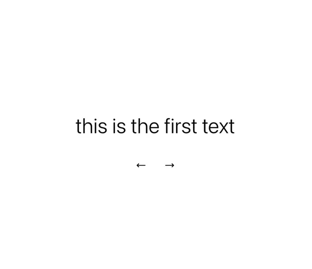

# Centred light text 'this is the first text' with left and right arrows on pure white

**Discipline:** web ·  · **Design style:** Minimalist
**Tags:** component, slider, text, white, arrows, minimal, typography, ui-kit

## What it is
A blank white frame with one line of light sans text and two thin arrow glyphs beneath, representing a text slider.

## What it means
Pure and quiet; only content and controls remain.

## Techniques
- Centre a single text line.
- Use thin arrows as controls.
- Keep everything on white.
- Let content swap in place.

## Best for
- Text carousel components
- Minimal quote sliders
- Component libraries

## Vocabulary
- **Text slider** — A component that swaps lines of text with arrows.
- **Arrow controls** — Simple left and right glyph buttons.
- **Empty stage** — A blank frame around one element.
- **Light sans** — A thin-weight sans-serif.
