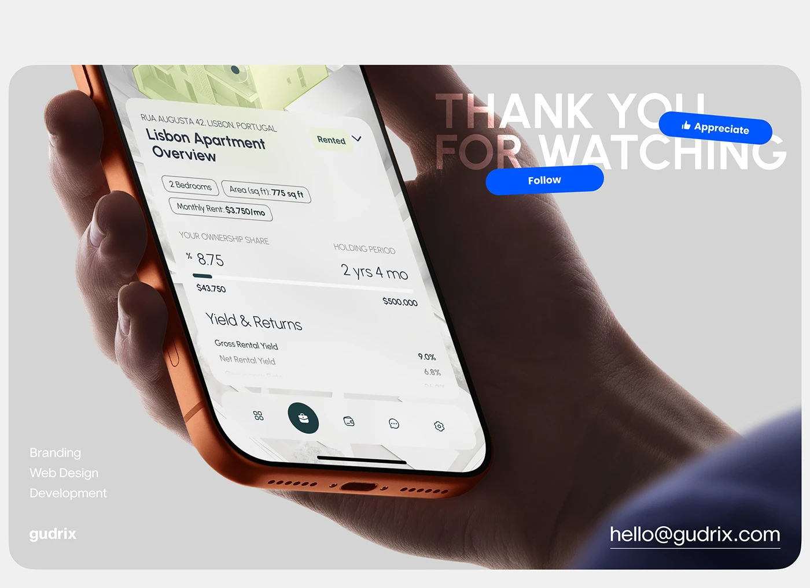

# Thank-you slide with an orange phone close-up in hand, blue pill buttons and contact details

**Discipline:** web ·  · **Design style:** Corporate & Clean-Tech
**Tags:** closing, hand, orange-phone, grey, blue-pills, contact, real-estate, fintech

## What it is
A grey rounded panel with a close-up of a hand holding an orange phone showing a property yield screen, giant faded 'THANK YOU FOR WATCHING', blue rotated 'Appreciate' and 'Follow' pills, a services list and an email.

## What it means
Friendly and social; platform-style buttons invite engagement.

## Techniques
- Enlarge a UI close-up as the backdrop.
- Overlay faded giant text.
- Tilt blue action pills.
- List services at the bottom left.

## Best for
- Case-study endings
- Behance-style sign-offs
- Fintech and property

## Vocabulary
- **Engagement pill** — A button-shaped prompt like Follow.
- **Faded giant text** — Large low-opacity words.
- **Close-up backdrop** — A magnified photo behind text.
- **Services list** — A short list of offered disciplines.
