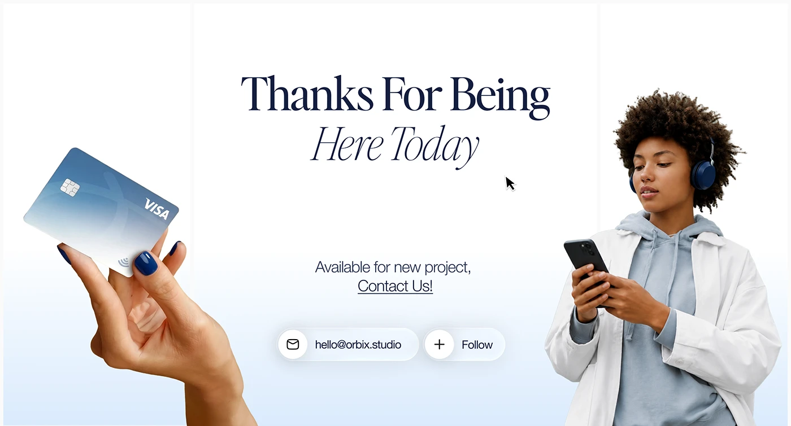

# Thanks slide with roman and italic serif, a hand holding a bank card, a walker with phone and glass contact pills

**Discipline:** web ·  · **Design style:** Editorial
**Tags:** closing, serif, italic, pale-blue, cutout, glass-pills, contact, follow

## What it is
A white-to-pale-blue slide with 'Thanks For Being Here Today' in navy serif and italic, a cut-out hand holding a gradient Visa card at left, a woman in a hoodie with headphones checking her phone at right, a cursor, and two glass pills with an email and a Follow button.

## What it means
Warm and professional; cutouts framing the text give a human sign-off.

## Techniques
- Frame a centred serif message with two cutouts.
- Set the second line in italic.
- Use glass pills for contact and follow.
- Fade the background to pale blue.

## Best for
- Fintech project sign-offs
- Closing slides
- Portfolio endings

## Vocabulary
- **Flanking cutouts** — Cutout images on both sides of a message.
- **Glass pill** — A translucent capsule button.
- **Roman/italic pair** — Regular and italic of one serif in two lines.
- **Sign-off slide** — A closing slide with thanks and contact.
