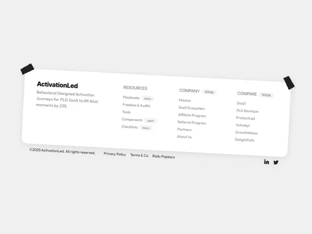

# White footer card rotated and held by black tape strips, with link columns and grey 'soon' tags

**Discipline:** web · **Design type:** UI components
**Tags:** component, footer, white, tape, tilted, links, soon-tags, playful

## What it is
A pale page where a white rounded footer card is tilted a few degrees and pinned at two corners by black tape, holding a bold logo and short description, three link columns (Resources, Company, Compare) with tiny grey 'soon' pills, and below a copyright line, legal links and two social icons.

## What it means
Playful and human; tape and tilt turn a standard footer into a pinned note.

## Techniques
- Rotate the footer card slightly.
- Tape it down with black strips.
- Add small 'soon' pills to links.
- Keep the layout in clean columns.

## Best for
- Playful SaaS footers
- Startup sites
- Footer components

## Vocabulary
- **Taped card** — A card that appears attached by tape strips.
- **Soon tag** — A small pill marking an upcoming link.
- **Link column** — A vertical list of footer links.
- **Tilted container** — A container rotated a few degrees.
