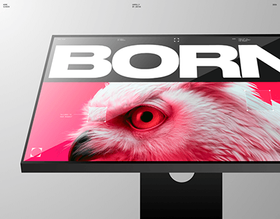

# Kiosk-style monitor tilted in grey with giant white BORN and a pink-tinted hawk eye photo with focus brackets

**Discipline:** web ·  · **Design style:** Minimalist
**Tags:** monitor, pink, white-type, hawk, focus-brackets, grey, minimal, project-cover

## What it is
A tilted monitor on a stand against a grey gradient showing a white bar with a huge black 'BORN' and a pink-red duotone close-up of a hawk's eye with viewfinder corner brackets and tiny captions.

## What it means
Fierce and precise; the pink hawk eye and camera brackets feel like a lens.

## Techniques
- Tilt a monitor in perspective.
- Use a duotone animal close-up.
- Add viewfinder corner brackets.
- Set a giant heavy word above.

## Best for
- Creative agency and campaign pages
- Duotone photo heroes
- Monitor mockups

## Vocabulary
- **Viewfinder brackets** — Corner marks like a camera frame.
- **Duotone close-up** — A macro photo in two colours.
- **Kiosk monitor** — A screen on a floor stand.
- **Giant word bar** — A white bar holding a huge headline.
