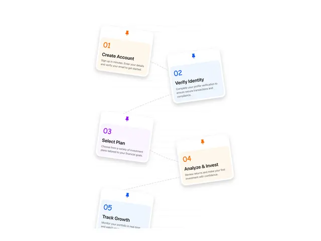

# Five tilted white step cards pinned with coloured push pins, each with a coloured number and tint, joined by a dashed path

**Discipline:** web · **Design type:** Landing page sections
**Tags:** process, steps, cards, pins, tilted, dashed-path, pastel, numbered

## What it is
A white page where five soft-shadow cards are placed in a staggered diagonal and rotated slightly, each with a coloured push pin, a large coloured number (01 orange, 02 blue, 03 purple, 04 orange, 05 blue), a bold title (Create Account, Verify Identity, Select Plan, Analyze & Invest, Track Growth), a short grey description in a tinted top area, and a dashed line linking them.

## What it means
Playful and clear; pins and tilt make a process feel like notes on a board.

## Techniques
- Pin and tilt each card.
- Tint each step in its own pastel.
- Link with a dashed connector.
- Use large coloured numerals.

## Best for
- Process and how-it-works sections
- Onboarding steps
- Pinboard-style layouts

## Vocabulary
- **Pinned card** — A card with a pin graphic at the top.
- **Step number** — A large numeral marking order.
- **Dashed connector** — A dotted line joining steps.
- **Tinted header** — A top area of a card with a soft colour.
