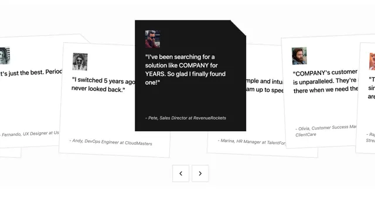

# Row of slightly rotated white testimonial cards with a large black focus card that has a clipped corner, and arrow buttons below

**Discipline:** web · **Design type:** UI components
**Tags:** component, testimonials, carousel, black, white, clipped-corner, tilted, avatars

## What it is
A white area with overlapping rotated white quote cards with small avatars and attributions, and one taller black card at the centre with a cut top-right corner holding a larger quote, avatar and attribution in italic, with two outlined square arrow buttons under it.

## What it means
Lively and tactile; tilt and a dark focus card make quotes feel like pinned notes.

## Techniques
- Rotate cards slightly.
- Make the focus card black with a clipped corner.
- Overlap neighbours behind it.
- Add square arrow controls.

## Best for
- Testimonial carousels
- Card stack components
- Black-and-white social proof

## Vocabulary
- **Focus card** — The active card, larger and in a contrasting colour.
- **Clipped corner** — A card with one corner cut off diagonally.
- **Tilted card** — A card rotated a few degrees.
- **Attribution line** — Name and company below a quote.
