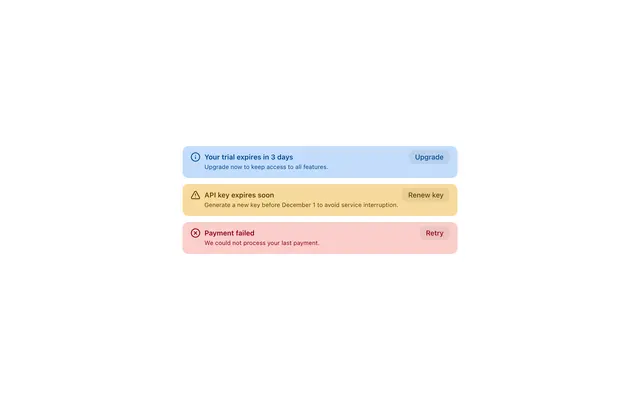

# Three stacked tinted alerts: blue trial notice, amber API-key warning and red payment failure, each with an icon and an action

**Discipline:** web · **Design type:** UI components
**Tags:** component, alerts, banners, blue, amber, red, actions, semantic-colour

## What it is
Three rounded banners on white: a soft blue 'Your trial expires in 3 days' with an info icon and an Upgrade button, an amber 'API key expires soon' with a warning triangle and Renew key, and a soft red 'Payment failed' with an error icon and Retry, each with bold title, a smaller description and a tinted button.

## What it means
Clear and calm; tonal fills and matching icons signal severity without alarm.

## Techniques
- Tint each banner in a semantic colour.
- Pair title with a one-line description.
- Add one tinted action button.
- Use matching icons.

## Best for
- Notification and alert components
- Billing warnings
- System status banners

## Vocabulary
- **Semantic alert** — A banner whose colour signals severity.
- **Tonal button** — A button tinted in the alert's colour.
- **Inline action** — A button placed inside the banner.
- **Severity ladder** — Info, warning and error levels.
