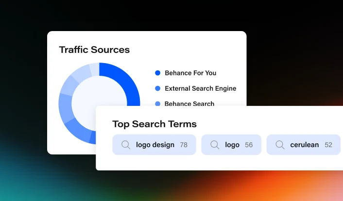

# White 'Traffic Sources' donut card with blue segments and legend, overlapped by a 'Top Search Terms' card with blue pills, on a black, teal and orange glow

**Discipline:** web · **Design type:** Feature illustration
**Tags:** feature-illustration, analytics, donut, blue, white, search-terms, dark, glow

## What it is
A dark background with teal, orange and green glows at the bottom, a white rounded card 'Traffic Sources' with a donut chart in graduated blues and a legend (Behance For You, External Search Engine, Behance Search), and overlapping at the bottom a wider white card 'Top Search Terms' with rounded pale-blue pills containing a search icon, a term and a count (logo design 78, logo 56, cerulean 52).

## What it means
Clear and layered; overlapping white cards make analytics feel like a peek into a product.

## Techniques
- Use graduated blues for donut segments.
- Overlap two cards for depth.
- Show terms as pills with counts.
- Set on a glowing dark background.

## Best for
- Analytics feature graphics
- Dashboard snippet illustrations
- Blue data cards on dark

## Vocabulary
- **Donut chart** — A ring chart with segments.
- **Term pill** — A capsule with an icon, keyword and count.
- **Overlapping cards** — Cards placed partly over each other.
- **Graduated palette** — Steps of one hue from dark to light.
