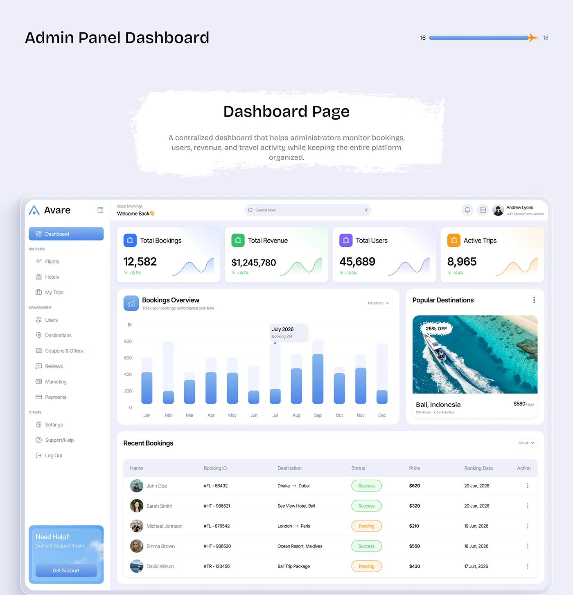

# Travel Admin Dashboard with Bookings Chart

**Discipline:** web ·  · **Design style:** Corporate & Clean-Tech
**Tags:** dashboard, admin, bar-chart, kpi, table, destinations, blue

## What it is
A lavender board with a torn-paper 'Dashboard Page' title above a light admin UI with four KPI cards, a monthly bookings bar chart with a highlighted July tooltip, a popular destination photo card and a recent bookings table.

## What it means
Soft blue charts with pastel KPIs and a photo card feel welcoming for an operations tool.

## Techniques
- Bar chart with faded track bars behind the values
- Photo card for destination breaking up the data
- Status pills for booking states
- Coloured icon tiles on KPI cards
- Sidebar with grouped sections and support card

## Best for
- Admin dashboards
- Travel platform back-offices
- Chart and table layouts

## Vocabulary
- **Track bar** — A faded bar behind a value bar showing the maximum.
- **Tooltip pin** — A floating label marking a chart value.
- **Sidebar group** — Navigation items grouped under small headings.
