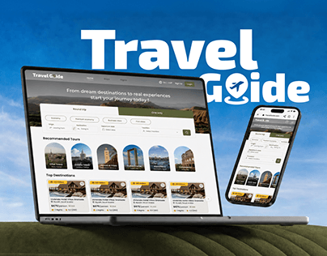

# Travel Guide case study cover: laptop and phone on a green hill with a huge white wordmark

**Discipline:** web · **Design type:** Project cover · **Design style:** Photographic & Cinematic
**Tags:** travel, case-study-cover, blue-sky, wordmark, laptop, phone

## What it is
A cover with a blue sky, a big white 'Travel Guide' wordmark where the 'G' holds a plane and pin, and a laptop and phone resting on a rounded green hill showing the tours website with arched destination cards.

## What it means
Open and aspirational; sky and hill make the devices feel outdoors.

## Techniques
- Set devices in a simple landscape instead of a desk.
- Hide a travel icon inside a letter.
- Use arched cards for destinations.

## Best for
- Travel sites
- Portfolio covers
- Tourism apps

## Vocabulary
- **Letter icon** — A symbol placed inside a letterform.
- **Arched card** — An image card with a rounded top.
