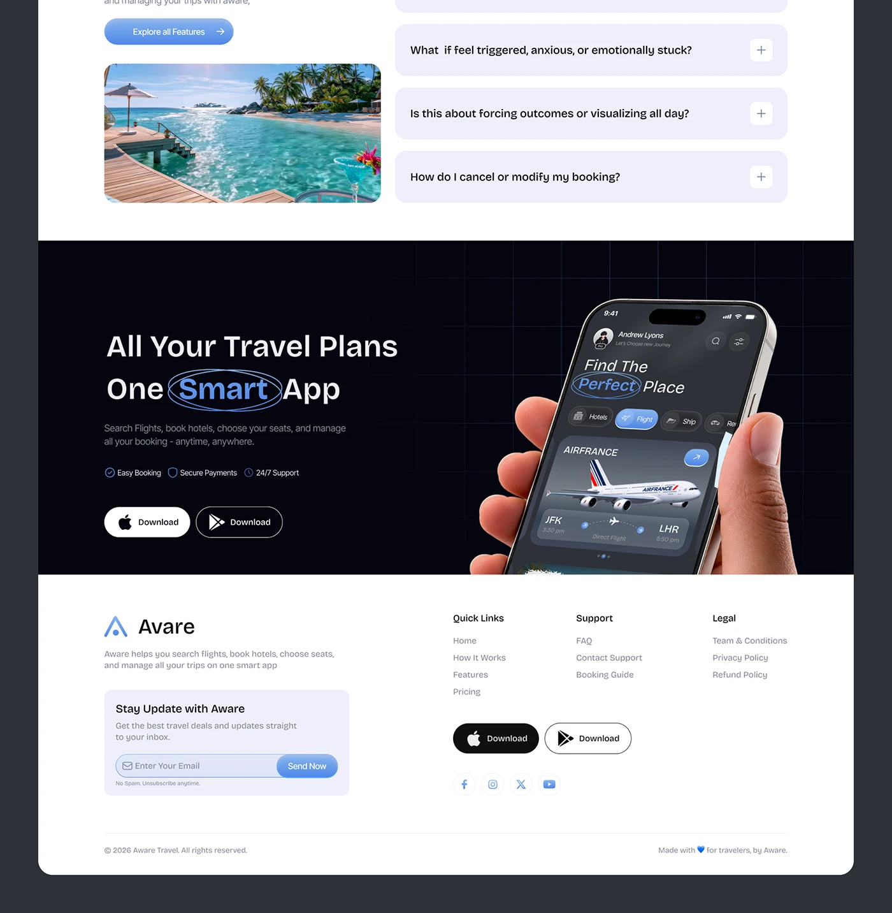

# Travel Landing FAQ, Dark Download Band and Footer

**Discipline:** web · **Design type:** Landing page sections
**Tags:** travel, faq, dark-band, footer, circled-word, download, blue

## What it is
The lower part of a travel landing page: a beach photo beside accordion FAQ rows, a black band with 'All Your Travel Plans One Smart App' and a hand holding a dark app screen, and a white footer with links and email signup.

## What it means
A dark band between light sections creates a strong closing moment, and the hand-held phone makes the download CTA tangible.

## Techniques
- Dark full-width band as the final CTA
- Circled word in the headline
- Hand-held phone breaking into the band
- Lavender FAQ accordions with plus toggles
- Footer with newsletter card and store buttons

## Best for
- Landing page endings
- App download sections
- Travel and booking sites

## Vocabulary
- **CTA band** — A contrasting full-width section carrying the final call to action.
- **Accordion** — A list of rows that expand to reveal answers.
- **Newsletter card** — A boxed email signup in a footer.
