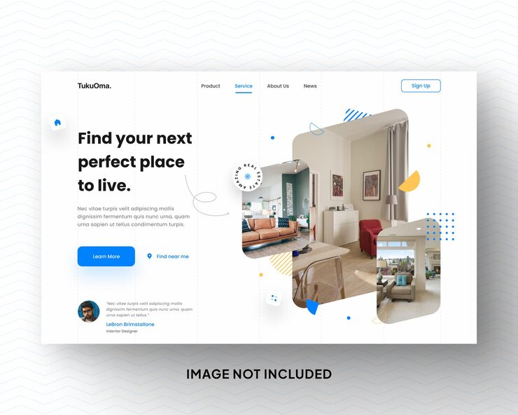

# TukuOma real estate hero with skewed interior photo cards, a rotating text badge and blue accents

**Discipline:** web · **Design type:** Landing page hero · **Design style:** Minimalist
**Tags:** real-estate, hero, blue, interior, badge, testimonial

## What it is
A white hero with dashed column guides, 'Find your next perfect place to live.' in bold black, a blue 'Learn More' button and 'Find near me' pin link, a cluster of three skewed rounded interior photos with a circular 'Amazing Real Estate' text badge, small yellow and blue shapes and a testimonial with avatar.

## What it means
Friendly and modern; skewed cards and small shapes add playful movement to property search.

## Techniques
- Skew overlapping photo cards for dynamism.
- Add a circular text badge at a card corner.
- Show faint column guides as a design detail.
- Include a testimonial in the hero.

## Best for
- Real estate sites
- Rental platforms
- Interior showcases

## Vocabulary
- **Skew** — Slanting a shape along one axis.
- **Column guides** — Visible vertical grid lines.
