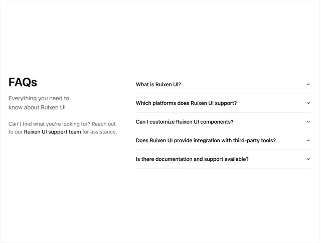

# Two-column FAQ: 'FAQs' heading, grey subline and support link at the left, five hairline-separated questions with chevrons at the right

**Discipline:** web ·  · **Design style:** Minimalist
**Tags:** component, faq, two-column, white, hairline, chevrons, minimal, support-link

## What it is
A white page with a bold 'FAQs' and grey lines at the left including a bold link to the support team, and at the right five bold questions separated by hairlines each with a small chevron.

## What it means
Calm and scannable; the split keeps context left and answers right.

## Techniques
- Split heading and list into two columns.
- Separate questions with hairlines.
- Use small chevrons.
- Keep a support link in the heading text.

## Best for
- FAQ sections
- Help centres
- Minimal documentation

## Vocabulary
- **Two-column FAQ** — Heading on one side and questions on the other.
- **Hairline list** — Items divided by thin rules.
- **Support link** — An inline link to contact help.
- **Chevron** — A small arrow showing expandability.
