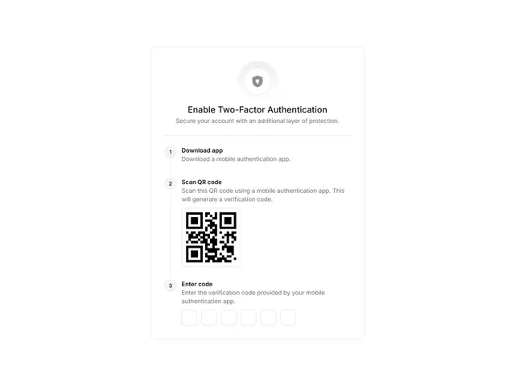

# White card 'Enable Two-Factor Authentication' with a shield icon, a vertical numbered timeline, a QR code and six code boxes

**Discipline:** web ·  · **Design style:** Minimalist
**Tags:** component, two-factor, security, white, timeline, qr-code, code-input, minimal

## What it is
A white rounded card with a soft circle holding a shield icon, a centred bold title and grey subtitle, a hairline and three numbered steps linked by a thin vertical line: Download app, Scan QR code with a QR image, and Enter code with six empty rounded input boxes.

## What it means
Clear and reassuring; a numbered timeline makes a security setup feel manageable.

## Techniques
- Show steps on a vertical timeline.
- Place the QR inside the step it belongs to.
- Use six separate code boxes.
- Use a soft icon halo.

## Best for
- Security setup flows
- Stepwise settings cards
- OTP input components

## Vocabulary
- **Vertical timeline** — Numbered steps joined by a vertical line.
- **Code input** — Separate boxes for each digit of a code.
- **Icon halo** — A soft circle behind an icon.
- **Setup card** — A card guiding a multi-step task.
