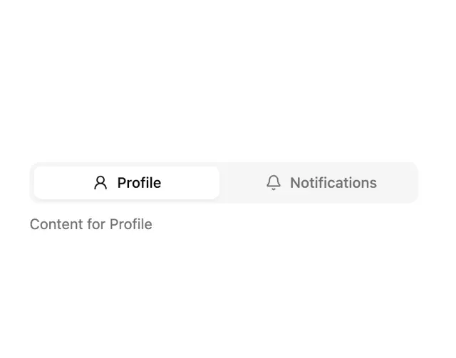

# Two-tab segmented control with a raised white active pill and a content line 'Content for Profile'

**Discipline:** web ·  · **Design style:** Minimalist
**Tags:** component, tabs, segmented, white, grey, icons, minimal, ui-kit

## What it is
A white frame with a grey rounded track split into Profile (active, white raised pill with a person icon) and Notifications (bell icon, grey text) and a grey line of content below.

## What it means
Simple and clear; the raised pill shows selection with almost no ink.

## Techniques
- Split a track into two equal segments.
- Raise the active one as a white pill.
- Grey the inactive label.
- Show content directly beneath.

## Best for
- Tabbed panels
- Settings pages
- Minimal switchers

## Vocabulary
- **Segmented control** — A track of two or more exclusive options.
- **Active pill** — The selected segment shown as a raised capsule.
- **Tab panel** — The content area shown for the selected tab.
- **Grey track** — The recessed background behind the segments.
