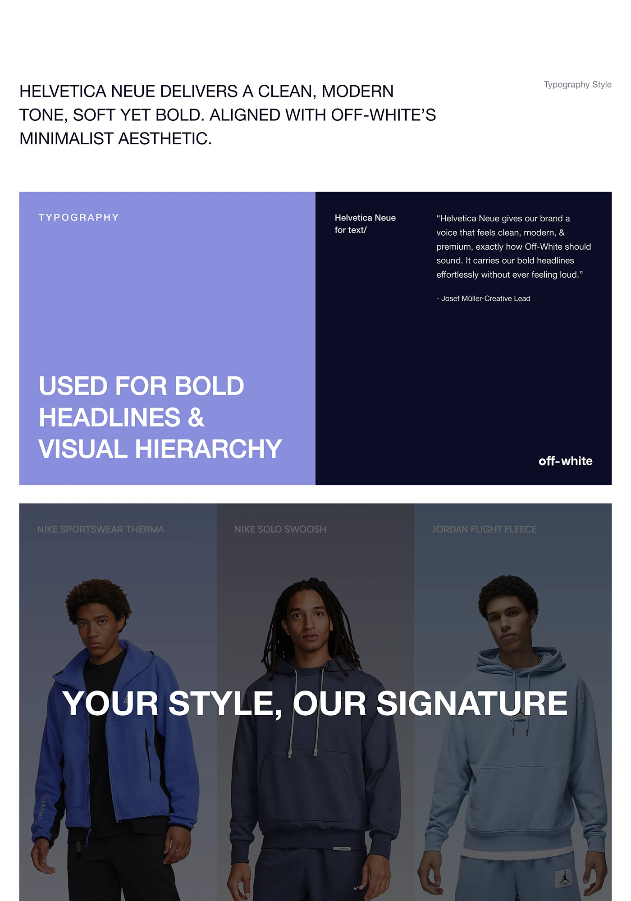

# Typography style page with periwinkle block, navy quote and three-model banner

**Discipline:** web ·  · **Design style:** Minimalist
**Tags:** typography, periwinkle, navy, fashion, helvetica, uppercase, quote, tinted-photos

## What it is
A white page with an uppercase statement, then a two-part block: a periwinkle panel with 'TYPOGRAPHY' and huge white 'USED FOR BOLD HEADLINES & VISUAL HIERARCHY', and a navy panel with a quote. Below is a tinted photo trio of three models in blue hoodies with a large white overlaid headline 'YOUR STYLE, OUR SIGNATURE'.

## What it means
Confident and minimal; the type does the talking, tinted photos keep it cohesive.

## Techniques
- Set the type rule as a real headline example instead of a specimen.
- Split a wide block into a light periwinkle and a deep navy half.
- Tint a row of photos with a blue overlay so headline text reads across all.
- Keep all text in one grotesque family.

## Best for
- Fashion and e-commerce brand guides
- Typography documentation
- Systems that show rules by example

## Vocabulary
- **Type-in-use** — Showing a typeface within a real headline.
- **Colour overlay** — A translucent tint over photos.
- **Split block** — A panel divided in two colours.
- **Statement caps** — A long sentence set in uppercase.
