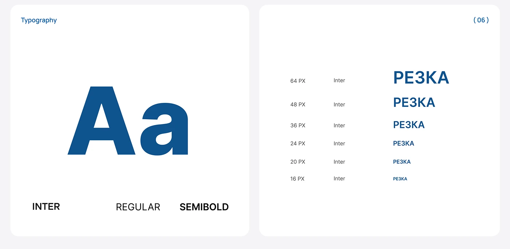

# Two rounded white cards with a giant blue Aa and a size ladder in blue Cyrillic

**Discipline:** web · **Design type:** Typography and colour guide
**Tags:** typography, specimen, blue, white, size-scale, inter, cards, documentation

## What it is
A pale grey board with two rounded white cards: one with a huge blue 'Aa' with Inter, Regular and Semibold labels; another '(06)' listing sizes from 64px to 16px with the same word in decreasing blue bold type.

## What it means
Clear and systematic; a scale ladder shows hierarchy at a glance.

## Techniques
- Set a giant Aa in brand colour.
- List weights beneath.
- Show a ladder of type sizes.
- Use two side-by-side cards.

## Best for
- Design system typography pages
- B2B web guidelines
- Blue-branded systems

## Vocabulary
- **Size ladder** — A list of the same text at different sizes.
- **Weight labels** — Names of the font weights in use.
- **Giant Aa** — An oversized type sample.
- **Spec card** — A rounded card documenting a rule.
