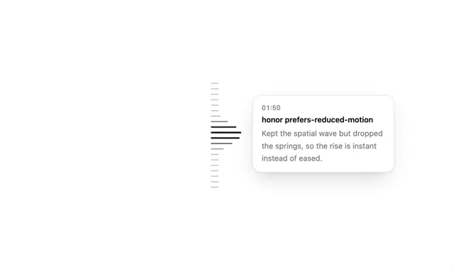

# Vertical ruler of grey dashes where nearby dashes grow long and black, pointing to a white timestamp note '01:50' with a bold line

**Discipline:** web · **Design type:** UI components
**Tags:** component, ruler, timeline, tooltip, white, black, wave, motion

## What it is
A white page with a vertical column of short horizontal dashes; those near the centre extend and turn black like a magnified wave, and a white rounded card with a soft shadow at their right shows '01:50', a bold line 'honor prefers-reduced-motion' and a grey explanation.

## What it means
Precise and delightful; a magnifying-dock effect makes a scrub bar feel tactile.

## Techniques
- Scale nearby ticks in a wave.
- Turn active ticks black.
- Attach a timestamped note.
- Keep everything monochrome.

## Best for
- Timeline scrubbers
- Changelog and history navigation
- Dock-like interactions

## Vocabulary
- **Tick ruler** — A column of small marks used as an index.
- **Magnify wave** — Nearby items growing like a dock effect.
- **Timestamp note** — A card labelled with a time.
- **Reduced motion** — An accessibility setting that limits animation.
