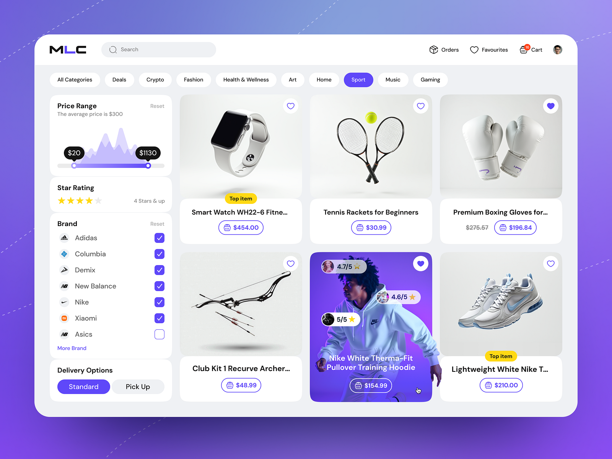

# Violet Marketplace with Filter Sidebar

**Discipline:** web · **Design type:** E-commerce storefront
**Tags:** marketplace, violet, filters, product-grid, rounded, cards, sport

## What it is
A rounded desktop window on a violet gradient with a search header, pill category tabs, a left filter sidebar (price histogram, stars, brands, delivery) and a grid of product cards, one highlighted as a purple photo card.

## What it means
A single violet accent on soft grey cards feels modern and friendly, and the histogram slider shows detail without heaviness.

## Techniques
- Price slider over a mini histogram
- Pill tabs for categories with one filled
- One product card inverted with a full-bleed photo and rating chips
- Checkbox list with brand logos
- Cutout product photos on pale gray tiles

## Best for
- Marketplaces and retail
- Filter-heavy browsing UIs
- Dashboard-style storefront concepts

## Vocabulary
- **Histogram slider** — A range slider drawn over a bar chart of the value distribution.
- **Featured card** — A product card styled differently to stand out.
- **Pill tabs** — Rounded tab buttons for switching category.
