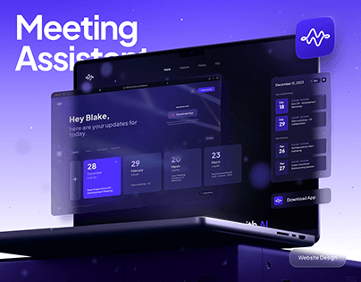

# Violet Meeting Assistant Site with Glass Panels

**Discipline:** web ·  · **Design style:** Glassmorphism
**Tags:** laptop, violet, dark, glass, floating, ai, website, cover

## What it is
A violet gradient cover with a giant white 'Meeting Assistant' title partly behind a dark laptop that shows a dark AI meeting site, with a translucent site panel floating in front, a calendar panel and Download App card at the right, an app icon tile at the top right and a Website Design pill.

## What it means
Layers of floating glass panels around a dark laptop explode the site into parts and give depth to a dark UI.

## Techniques
- Floating translucent panels in front of the device
- Giant title partly hidden behind the laptop
- Violet gradient with soft glow
- App icon tile as a brand stamp
- Dark UI with lit calendar cards

## Best for
- SaaS website case-study covers
- AI meeting and productivity tools
- Layered glass mockups

## Vocabulary
- **Floating panel** — A UI panel pulled out of the screen and floated in front.
- **Layered mockup** — A scene with elements at several depths.
- **Brand stamp** — A small icon tile signing the composition.
