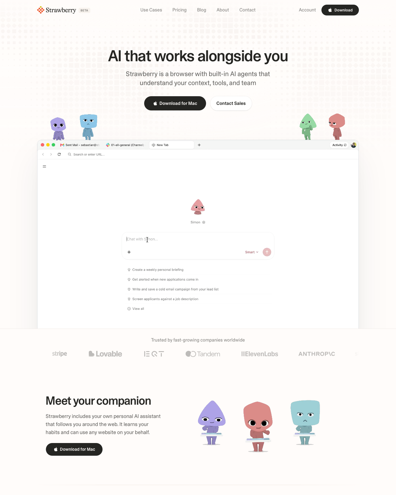

# Cream Landing Page with Pixel Mascots

**Discipline:** web · **Design type:** SaaS landing page
**Tags:** cream, mascots, ai, browser-mockup, logo-strip, friendly, serif-logo

## What it is
A long landing page on warm off-white with a dark serif wordmark, a bold sans headline, dark pill CTA, a browser mockup with small colored character mascots perched on top, a logo marquee and a 'Meet your companion' feature block.

## What it means
Soft cream and toy-like characters make AI feel gentle and personable instead of cold. The dotted halftone at the top adds subtle texture.

## Techniques
- Mascots sitting on the edge of the browser mockup as if peeking in
- Tight heavy headline against light regular-weight subhead
- Grayscale logo strip for trust signals without visual noise
- Dark pill buttons as the only strong contrast
- Pale dotted texture fading down from the top

## Best for
- AI assistants and productivity tools
- Products wanting a friendly personality
- Consumer-leaning software launches

## Vocabulary
- **Mascot perch** — Characters placed on top of a UI frame to interact with it.
- **Logo marquee** — A row of muted partner or customer logos.
- **Halftone texture** — A dot-pattern gradient used as subtle background texture.
