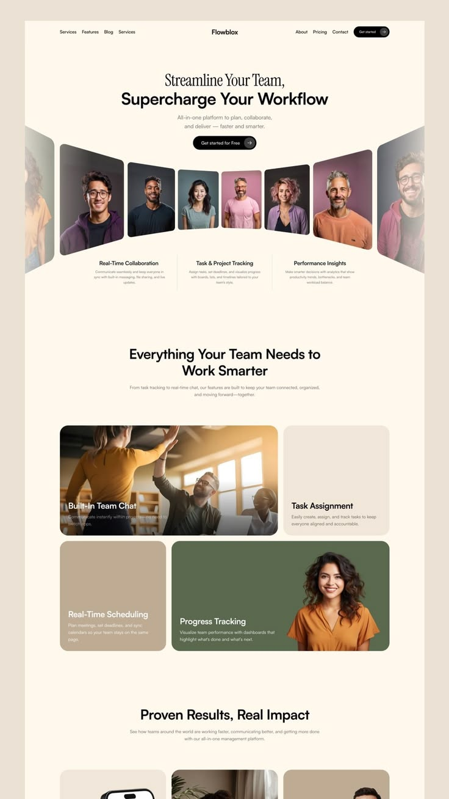

# Cream SaaS landing with a curved portrait carousel hero

**Discipline:** web ·  · **Design style:** Warm & Organic
**Tags:** saas, cream, serif-sans-mix, portrait-carousel, bento, earth-tones, team-collaboration

## What it is
A cream landing page for a workflow tool. A serif line sits above a bold sans headline and a black CTA. Below, a row of portraits is bent in perspective like a curved wall, followed by a bento grid of rounded cards in beige, olive and tan mixing photos and text.

## What it means
Warm, human and organised; earthy tones feel less corporate than usual SaaS blue.

## Techniques
- Combine a light serif phrase with a heavy sans phrase in one headline for contrast.
- Warp a photo row in perspective to make a flat page feel three-dimensional.
- Build feature blocks as a bento grid of soft rounded rectangles in muted earth tones.
- Overlay white text on photo tiles with a gentle gradient for legibility.
- Keep one black pill CTA.

## Best for
- Team, HR and productivity software
- Brands wanting humane B2B warmth
- Service platforms with real customer faces

## Vocabulary
- **Bento grid** — A layout of rounded tiles of different sizes, like a lunchbox.
- **Perspective carousel** — An image row angled to appear curved.
- **Earth palette** — Beige, olive, clay and brown tones.
- **Serif-sans pairing** — Mixing serif and sans within one heading.
