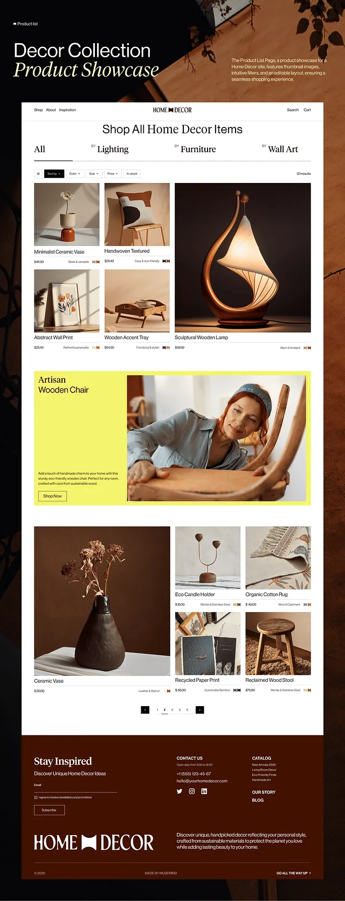

# Earthy home-decor product grid with acid-yellow feature band

**Discipline:** web ·  · **Design style:** Editorial
**Tags:** e-commerce, product-grid, earthy, brown, serif-italic, acid-yellow, editorial, home-decor

## What it is
A product list page presented over a dark rust backdrop with a mixed serif headline. The store shows a filter bar, a masonry grid of warm-lit product photos with names and prices, an acid-yellow feature block with a craftsperson photo, pagination, and a deep brown footer with a large wordmark.

## What it means
Handmade, warm and considered; the yellow band adds a jolt of energy to an otherwise tonal palette.

## Techniques
- Vary tile sizes so one hero product spans two rows and creates rhythm in the grid.
- Pair a light sans body with italic serif category names for boutique elegance.
- Interrupt the grid with one full-width acid-yellow storytelling band.
- Tint photography toward one warm palette so products feel like a set.
- Use small metadata (material icons, tags) under prices as quiet detail.

## Best for
- Home, craft and lifestyle e-commerce
- Boutique brands with strong photography
- Marketplace category pages

## Vocabulary
- **Masonry grid** — A grid whose tiles differ in size and interlock without gaps.
- **Feature band** — A full-width block that breaks up repeated content.
- **Tonal palette** — A palette of one hue family in varying values.
- **Italic serif accent** — Using italic serif for labels to add elegance.
