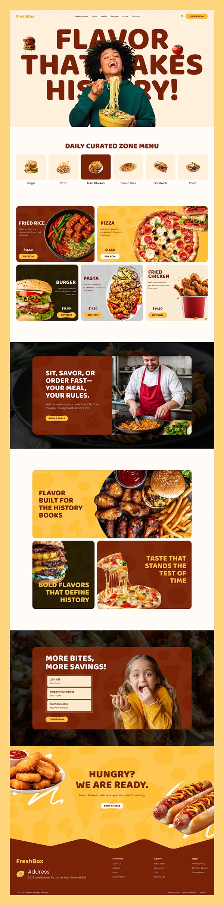

# Brown and yellow food site with giant 'FLAVOR THAT MAKES HISTORY!' behind a laughing noodle eater and rounded photo cards

**Discipline:** web ·  · **Design style:** Warm & Organic
**Tags:** food, restaurant, brown, yellow, cream, giant-type, photo-cards, rounded

## What it is
A long cream page with a heavy brown headline whose letters are overlapped by a cutout woman eating noodles, a category row of six tinted tiles with one dark selected, dish cards in dark brown, yellow and grey with food photos and yellow Buy Now pills, dark photo sections with a chef and a smiling child in brown cards, a yellow wavy footer band and a brown footer.

## What it means
Warm and hungry; brown and yellow feel like comfort food and the joyful diner sells the flavour.

## Techniques
- Put a cutout person in front of a giant headline.
- Use rounded photo cards in warm colours.
- Alternate cream, dark photo and yellow bands.
- End with a wavy divider into the footer.

## Best for
- Restaurant and food delivery sites
- Warm brown-yellow brands
- Photo-card layouts

## Vocabulary
- **Type behind subject** — Giant text partly hidden by a cutout person.
- **Category tile row** — A row of icons for food types.
- **Dish card** — A coloured card with a dish photo and price.
- **Wavy footer** — A wave-shaped edge above the footer.
