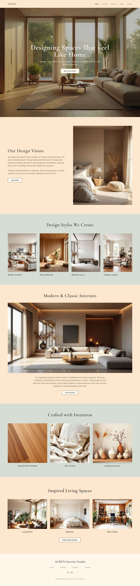

# Interior studio site alternating peach and sage bands with elegant serif headings and warm room photography

**Discipline:** web · **Design type:** Landing page
**Tags:** interior, peach, sage, serif, photography, minimal, long-scroll, warm

## What it is
A long page with a peach full-bleed living room hero with a centred serif headline, a two-column vision section with a bedroom photo, a sage band with four style photos and captions, a peach section with a wide living room, a sage band with three material photos and a peach living-spaces trio with an outlined button, ending in a cream footer with a serif name.

## What it means
Warm and calm; peach and sage bands with serif type feel like a quiet showroom.

## Techniques
- Alternate peach and sage bands.
- Use elegant light serif headings.
- Show captioned photo rows.
- Use small outlined buttons.

## Best for
- Interior and home-decor studios
- Warm pastel band layouts
- Photo-led minimal sites

## Vocabulary
- **Band alternation** — Sections switching between two colours.
- **Captioned photo row** — A row of photos with small labels.
- **Serif heading** — A heading in an elegant serif.
- **Outlined button** — A button with a border only.
