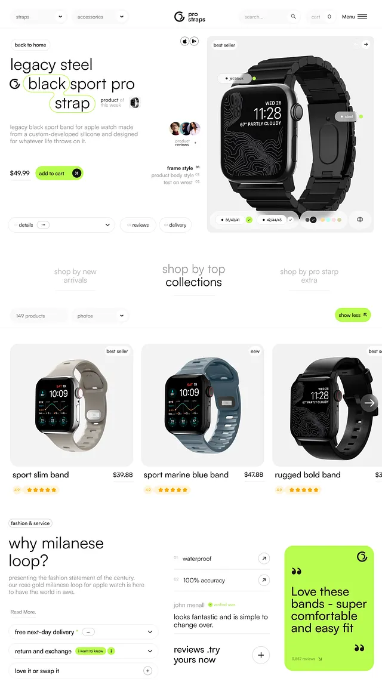

# Compact view of the watch-strap store: outlined-word headline, product card, best-sellers and lime quote card

**Discipline:** web ·  · **Design style:** Playful & Illustrated
**Tags:** e-commerce, watch, white, lime, product-page, outlined-keyword, best-sellers, responsive

## What it is
A long white page with tab dropdowns and a nav, a hero with a lowercase headline where 'black' is outlined in lime, a large black watch card with size and colour pickers and a lime add to cart, a 'shop by top collections' tab row, three product cards with star ratings, a 'why milanese loop?' text block with accordions and a lime testimonial card.

## What it means
Crisp and friendly; consistent pills and lime highlights keep a dense product page airy.

## Techniques
- Use accordions for delivery and returns.
- Highlight ratings with yellow stars in pills.
- Use one lime block for social proof.
- Keep the product card large.

## Best for
- Product detail and listing pages
- Accessory stores
- Lime accent sites

## Vocabulary
- **Accordion row** — An expandable line for details.
- **Star pill** — A rating shown in a small capsule.
- **Tab row** — Text tabs switching collections.
- **Social proof block** — A coloured card with a customer quote.
