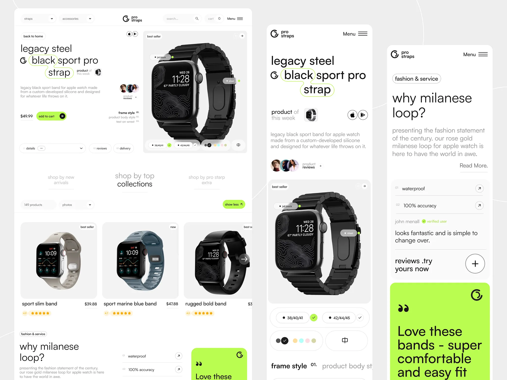

# Watch-strap store in white, grey and electric lime: outlined keyword headline, product card, best-seller grid and a lime quote block

**Discipline:** web ·  · **Design style:** Minimalist
**Tags:** e-commerce, watch, white, lime, lowercase, outlined-keyword, product-grid, mobile

## What it is
Three views: a desktop page with a lowercase headline 'legacy steel black sport pro strap' where words are wrapped in lime outlined pills, a price and lime add-to-cart, a large product card with a black watch and colour and size selectors, a 'shop by' tab row, a three-product grid with stars, and a 'why milanese loop?' section with a lime testimonial card; a long mobile version and a second mobile screen with text and lime quote block.

## What it means
Clean and fresh; lime accents on a quiet white grid give a tech-accessory feel.

## Techniques
- Wrap headline words in thin lime outlines.
- Use one lime for buttons and quote block.
- Round product tiles in light grey.
- Keep type lowercase and light.

## Best for
- Tech accessory and wearable stores
- Lime and white e-commerce
- Lowercase minimal sites

## Vocabulary
- **Outlined keyword** — A word inside a thin coloured outline.
- **Lime quote block** — A bright green card holding a testimonial.
- **Selector pill** — A capsule for size or colour choice.
- **Lowercase voice** — All text set in lowercase.
