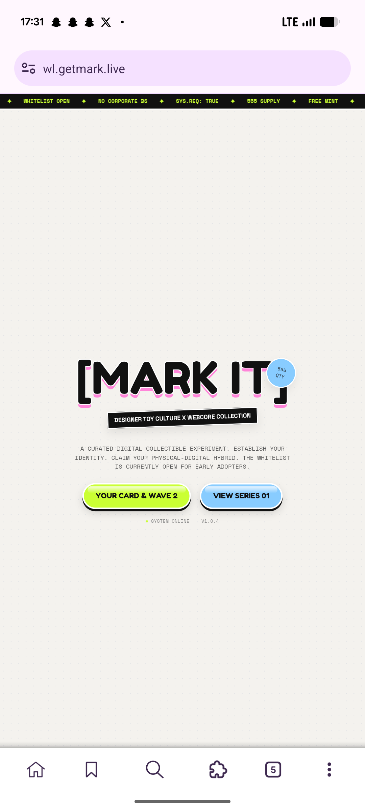

# Webcore Toy Collectible Whitelist Hero

**Discipline:** web ·  · **Design style:** Neo-Brutalist
**Tags:** webcore, y2k, sticker, lime, blue, ticker, monospace, whitelist

## What it is
A mobile landing page on a dotted off-white ground with a black ticker strip of lime monospace slogans, a huge black bracketed '[MARK IT]' title with a pink offset outline and a blue round '555 QTY' sticker, a tilted black label 'Designer Toy Culture x Webcore Collection', a monospace paragraph and two glossy pill buttons in lime and sky blue.

## What it means
Bracketed type, hard offsets and glossy candy buttons mix toy culture with terminal aesthetics for a knowing, playful web3 tone.

## Techniques
- Heavy title with a pink offset outline
- Tilted black label as a strip of tape
- Round sticker overlapping the title
- Glossy candy pill buttons with a black underlay
- Monospace ticker and body text

## Best for
- Web3 collectible and whitelist pages
- Y2K and webcore aesthetics
- Playful mobile landing pages

## Vocabulary
- **Webcore** — A style borrowing early-web and terminal visuals.
- **Ticker strip** — A band of scrolling slogans across the top.
- **Candy button** — A glossy rounded button with a hard shadow.
