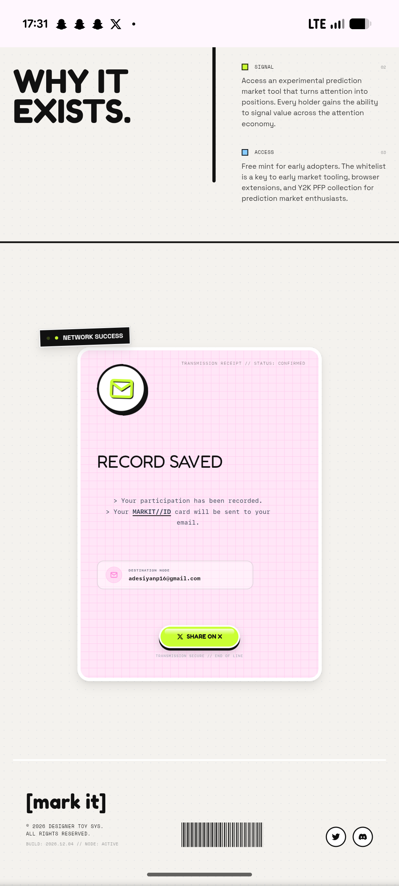

# Webcore Footer with Barcode and Bracket Wordmark

**Discipline:** web · **Design type:** Landing page sections
**Tags:** footer, barcode, wordmark, monospace, webcore, social-icons, pink

## What it is
The lower part of the same mobile page: the manifesto points, the pink receipt card and a footer with a bracketed lowercase '[mark it]' wordmark, tiny monospace legal and build lines, a barcode graphic and round outlined social icons.

## What it means
A barcode and build number in the footer finish the toy-package joke and give the page a product-label feel.

## Techniques
- Barcode as a decorative footer element
- Bracketed wordmark as a sign-off
- Build and node status lines in monospace
- Round outlined social icons
- Hairline rules between sections

## Best for
- Footer design with personality
- Product-label aesthetics
- Webcore and toy-culture sites

## Vocabulary
- **Barcode graphic** — Parallel bars used as decoration or label.
- **Sign-off wordmark** — A logo placed at the very end of a page.
- **Build line** — A small line listing version or date, as in software.
