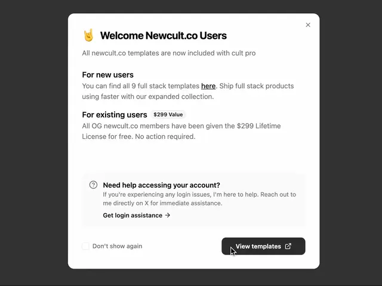

# Light modal 'Welcome Newcult.co Users' with an emoji title, a $299 value chip, a grey help box and a dark View templates button

**Discipline:** web ·  · **Design style:** Playful & Illustrated
**Tags:** component, modal, announcement, white, emoji, help-box, checkbox, dark-button

## What it is
A white rounded dialog on dark grey with an emoji and bold title, an x, sections 'For new users' and 'For existing users' with a small $299 Value chip, a grey inset help box with a question icon and a Get login assistance link, a 'Don't show again' checkbox and a dark View templates button with an external-link icon.

## What it means
Friendly and informative; sections, a value chip and a help box keep a long notice scannable.

## Techniques
- Use bold subheads for audiences.
- Add a small value chip.
- Put help in a tinted inset.
- End with a dismiss checkbox and one dark button.

## Best for
- Announcement and onboarding modals
- Migration notices
- Light dialog components

## Vocabulary
- **Value chip** — A small label stating a worth or price.
- **Help inset** — A tinted box with support information.
- **Don't-show-again** — A checkbox to suppress a dialog.
- **External link button** — A button with an outward arrow icon.
