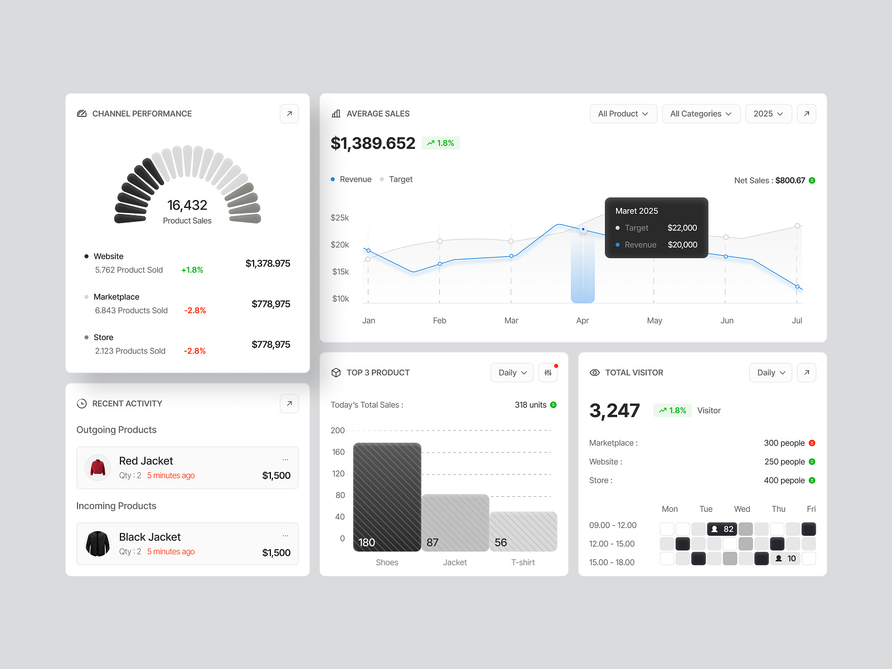

# Sales Analytics Widget Board

**Discipline:** web ·  · **Design style:** Corporate & Clean-Tech
**Tags:** analytics, widgets, white, gauge, line-chart, hatch-bars, heatmap

## What it is
A pale grey board of white dashboard cards: a segmented semicircle gauge with channel performance, an average sales line chart with a dark tooltip, recent activity product rows, a top-three bar chart with hatched bars and a visitor heat grid with dark cells.

## What it means
Monochrome cards with one blue accent line make data feel clean, and varied chart shapes keep interest.

## Techniques
- Segmented gauge with fading dark to light petals
- Hatched bars in graded greys
- Dark tooltip on a light chart
- Heat grid of dark and light squares
- Blue as the only colour for a key line

## Best for
- Dashboard widget showcases
- Monochrome data visualisation
- Sales and retail analytics

## Vocabulary
- **Petal gauge** — A gauge made of rounded petal-like segments.
- **Heat grid** — A grid of cells shaded by value.
- **Widget board** — A collection of dashboard cards shown together.
