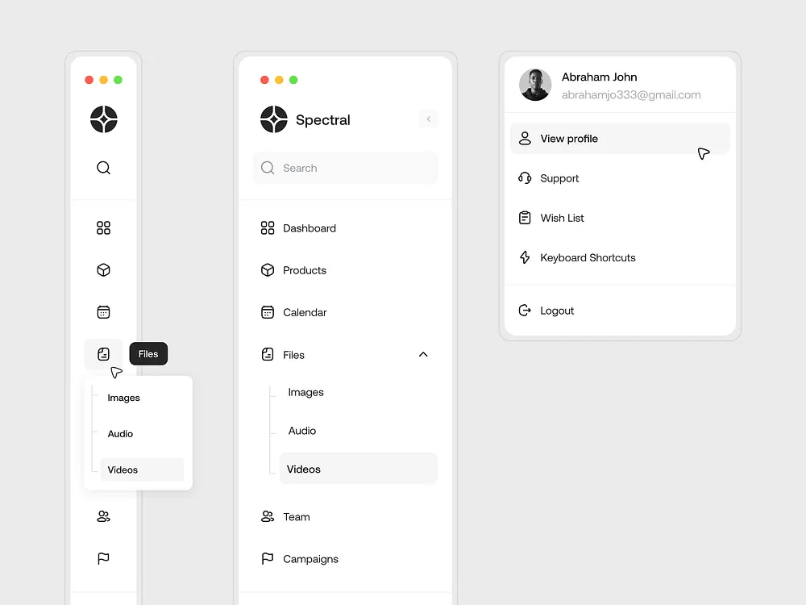

# White Sidebar Navigation with Profile Menu

**Discipline:** web · **Design type:** UI components
**Tags:** sidebar, navigation, white, collapsed, submenu, profile-menu, cursor

## What it is
Three white app panels with window dots on grey: a collapsed icon rail with a Files tooltip and submenu (Images, Audio, Videos), an expanded sidebar with logo, search, grouped links and an expanded Files section, and a profile menu with view profile, support, wish list, shortcuts and logout.

## What it means
Showing the collapsed, expanded and profile states side by side explains a whole navigation system on one board, and monochrome line icons keep it calm.

## Techniques
- Collapsed and expanded states shown together
- Tooltip and flyout submenu on the icon rail
- Indented submenu with a tree line
- Profile menu as a separate dropdown
- Cursor icons implying interaction

## Best for
- Sidebar navigation documentation
- SaaS and admin app UI
- Monochrome component showcases

## Vocabulary
- **Icon rail** — A narrow bar of icons that expands into a full sidebar.
- **Tooltip** — A small label shown on hover.
- **Tree line** — A thin vertical line joining nested menu items.
