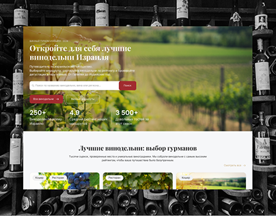

# Winery search site with a vineyard photo hero over a monochrome wall of wine bottles

**Discipline:** web ·  · **Design style:** Minimalist
**Tags:** travel, wine, vineyard, burgundy, serif, search-bar, monochrome-backdrop, cyrillic

## What it is
A greyscale photo of a wall of bottles behind a white browser-like page. The hero is a green vineyard photo with a serif headline, a search field with a red button, three stats (250+, 4.9, 3 500+) and below a section 'Best wineries' with photo cards.

## What it means
Warm and refined; the greyscale bottle wall makes the vineyard colour pop.

## Techniques
- Use a monochrome themed backdrop around the UI.
- Overlay a search bar on a photo hero.
- Show three key stats in the hero.
- Use a burgundy accent button.

## Best for
- Wine and travel guides
- Directory sites with search
- Photo-led heroes

## Vocabulary
- **Monochrome backdrop** — A greyscale image behind a UI.
- **Search hero** — A hero built around a search field.
- **Stat trio** — Three key numbers in a row.
- **Burgundy accent** — A deep red used for buttons.
