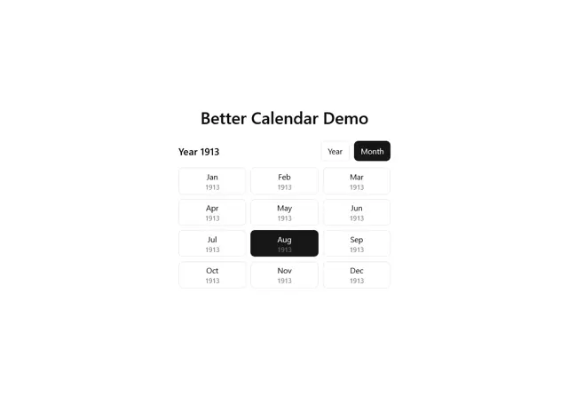

# 'Better Calendar Demo' month picker: a 3x4 grid of outlined tiles with month and year, a black selected month and a Year/Month toggle

**Discipline:** web ·  · **Design style:** Minimalist
**Tags:** component, date-picker, month-grid, white, black, toggle, minimal, ui-kit

## What it is
A white page with a bold title, a 'Year 1913' label with a two-part toggle (Year, Month active black) and a 3x4 grid of hairline-bordered tiles each showing a month name and the year in grey, with August selected as a black tile.

## What it means
Simple and precise; the black tile makes selection unmistakable.

## Techniques
- Use tiles with month over year.
- Highlight selection in solid black.
- Add a segmented toggle for view.
- Keep hairline borders.

## Best for
- Date picker components
- Month and year selectors
- Minimal form UI

## Vocabulary
- **Month grid** — A grid of month options.
- **Segmented toggle** — A two-option switch for view type.
- **Selected tile** — The chosen option shown as solid black.
- **Hairline tile** — A tile with a thin light border.
