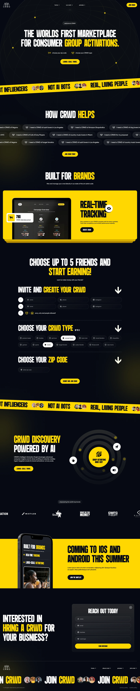

# Very tall black-and-yellow group-activation marketplace with condensed type and tape tickers

**Discipline:** web · **Design type:** Landing page
**Tags:** marketplace, black, yellow, condensed-type, ticker, forms, phone-mockup, long-scroll

## What it is
A near-black long page with tall condensed white and yellow headlines, yellow tape tickers of avatars and slogans, a yellow dashboard laptop card, numbered form steps with chip options, a radial AI discovery graphic, logo strip, a yellow phone section, a contact form and a footer ticker.

## What it means
Loud and streetwise; yellow tape and condensed type feel like live activation.

## Techniques
- Repeat a yellow tape ticker between sections.
- Use giant condensed headlines with yellow keywords.
- Alternate black and full-yellow bands.
- Build forms as numbered steps with chips.

## Best for
- Marketplaces and community platforms
- Youth and event brands
- Black and yellow identities

## Vocabulary
- **Tape ticker** — A scrolling strip of slogans.
- **Condensed headline** — Tall narrow uppercase text.
- **Chip option** — A small selectable pill.
- **Yellow band** — A full-width yellow section.
