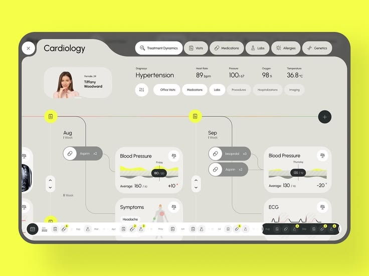

# Cardiology Timeline Dashboard on Yellow

**Discipline:** web · **Design type:** Dashboard
**Tags:** dashboard, medical, yellow, grey, timeline, tablet, tabs

## What it is
A rounded dark-framed tablet on a neon yellow backdrop showing a beige Cardiology dashboard with a curved tab header, a patient card and vitals, a horizontal timeline with medication pills, blood pressure cards with yellow charts, and a dark timeline scrubber at the bottom.

## What it means
A neutral beige UI with tiny yellow accents feels calm and clinical, and the neon backdrop makes the tablet pop.

## Techniques
- Curved tab header merging into the frame
- Yellow used only inside chart fills and node markers
- Timeline nodes connected by thin lines
- Pill toggles and rounded cards throughout
- Dark bottom scrubber with icon groups

## Best for
- Medical dashboards
- Timeline-based data views
- Neutral UI with a neon presentation backdrop

## Vocabulary
- **Timeline scrubber** — A bar for moving through periods of time.
- **Curved tab header** — A header with an organic curve joining its tabs.
- **Vitals strip** — A row of key health measurements.
