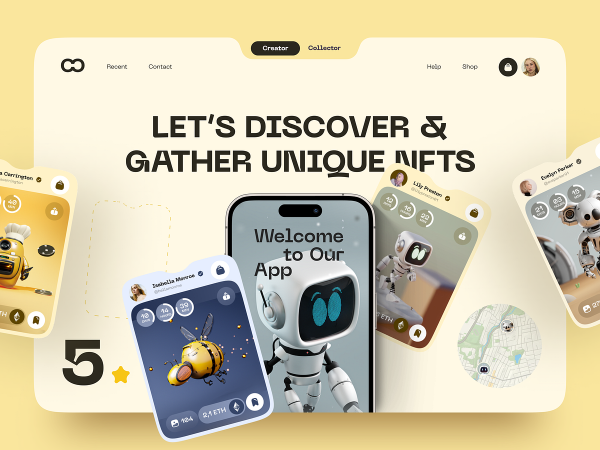

# Cream NFT Marketplace Hero with Robot Mascot

**Discipline:** web ·  · **Design style:** Warm & Organic
**Tags:** nft, cream, yellow, robot, 3d, notched-cards, display-type, marketplace

## What it is
A cream and butter-yellow rounded hero with a notched top holding Creator and Collector toggles, a nav, a heavy caps headline 'Let's Discover & Gather Unique NFTs', a phone showing a 3D robot mascot and tilted notched NFT cards with countdown rings, a big 5 with a star and a small map circle.

## What it means
Tilted tabbed cards, a friendly robot and warm cream tones make an NFT marketplace feel playful and trustworthy.

## Techniques
- Notched top and card corners like folder tabs
- Tilted cards of 3D characters around a phone
- Countdown rings on each card
- Heavy caps headline behind the cards
- Warm cream and yellow palette

## Best for
- NFT and collectible marketplaces
- 3D character-led heroes
- Warm playful web3 sites

## Vocabulary
- **Notched card** — A card with a cut-out corner or tab.
- **Countdown ring** — A circular timer around days, hours and minutes.
- **Mascot hero** — A 3D character placed at the centre of a hero.
